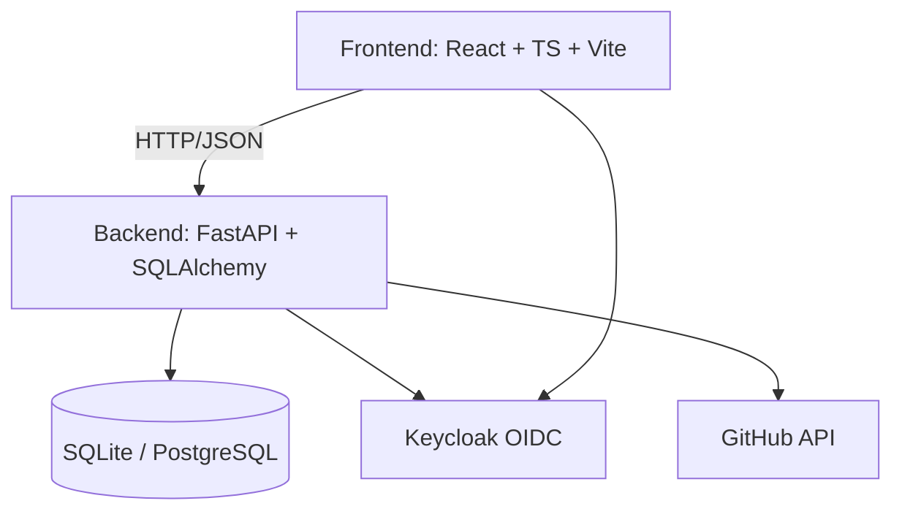

# Nexus Workbench

> Work in progress. This checkpoint may be incomplete or fail tests. See PLAN.md and STATUS.md before use.


**Alan Vo | AI & Machine Learning**

Open source repository of plugins primarily intended for knowledge workers to use in Claude Cowork.

## Overview

Nexus Workbench is a developer tool for browsing, evaluating, and managing plugins for the Claude Cowork platform. It aggregates plugin metadata, skills, and GitHub issues from the upstream [knowledge-work-plugins](https://github.com/anthropics/knowledge-work-plugins) repository, providing a searchable catalog with stability filtering and issue tracking.

## Features

- **Plugin Catalog** — Browse all available plugins with descriptions, domains, and status
- **Skill Browser** — View skills with stability lifecycle badges (experimental/stable/deprecated) per issue #253
- **Issue Tracker** — Sync and display GitHub issues with filtering by plugin/domain
- **AI/ML Focus** — Designed for AI/ML developer tools, agent evaluation, model quality, RAG, NLP, vision, AI safety, alignment evaluation, and AI infrastructure

## Architecture



## Quick Start

### Prerequisites

- Docker and Docker Compose
- Node 24+ (for local frontend development)
- Python 3.12+ (for local backend development)

### Using Docker Compose

```bash
# Clone the repository
git clone https://github.com/ALANDVO/nexus-workbench-145-alan-vo.git
cd nexus-workbench-145-alan-vo

# Copy environment template
cp .env.example .env

# Start all services
docker compose up -d

# Access the application
# Frontend: http://127.0.0.1:5173
# Backend API: http://127.0.0.1:8000
# Keycloak Admin: http://127.0.0.1:8080 (admin/admin)
```

### Local Development

**Backend:**
```bash
cd backend
python -m venv .venv
.venv/bin/pip install -r requirements.txt
.venv/bin/python -m uvicorn app.main:app --reload --host 127.0.0.1 --port 8000
```

**Frontend:**
```bash
cd frontend
npm install
npm run dev
```

## Testing

**Backend:**
```bash
cd backend
.venv/bin/python -m pytest tests -v
```

**Frontend:**
```bash
cd frontend
npm run build
npm test
```

## API Reference

- `GET /api/v1/health` — Health check endpoint

## Configuration

| Variable | Description | Default |
|----------|-------------|---------|
| `DATABASE_URL` | Database connection string | `sqlite+aiosqlite:///./nexus.db` |
| `KEYCLOAK_SERVER_URL` | Keycloak server URL | `http://127.0.0.1:8080` |
| `KEYCLOAK_REALM` | Keycloak realm | `nexus` |
| `KEYCLOAK_CLIENT_ID` | Keycloak client ID | `nexus-workbench` |
| `KEYCLOAK_CLIENT_SECRET` | Keycloak client secret | (required) |
| `CORS_ORIGINS` | Allowed CORS origins | `http://127.0.0.1:5173,http://localhost:5173` |
| `GITHUB_TOKEN` | GitHub API token for issue sync | (optional) |
| `GITHUB_REPO` | Upstream repository | `anthropics/knowledge-work-plugins` |

## Security

- OIDC authentication via Keycloak with PKCE
- Backend-managed sessions with HttpOnly SameSite=Strict cookies
- CSRF protection on mutating endpoints
- No hardcoded secrets; all credentials via environment variables
- Demo mode binds to localhost only; refuses to start in production

## AI/ML Evaluation

This application serves as a catalog for AI/ML plugins. Evaluation of individual plugin capabilities (e.g., agent reasoning, model quality, RAG effectiveness) is delegated to the upstream plugins themselves. This workbench provides the discovery and management layer.

## License

MIT License — Copyright (c) 2026 Alan Vo <alanvo@gmail.com>
